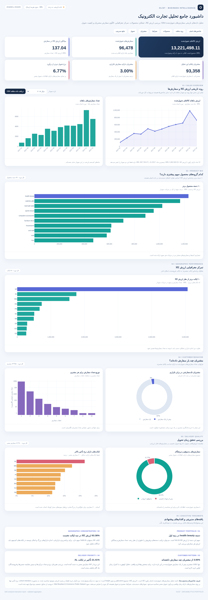

# Olist E-Commerce Analytics | Python & Interactive Dashboard

**End-to-end portfolio project** exploring historical Brazilian e-commerce orders with Python, Pandas, and an interactive Plotly dashboard.

[Dashboard preview](assets/dashboard-overview.png) · [Open offline dashboard](docs/index.html) · [Persian README](README_FA.md)



## Project overview

This project analyzes the public [Olist Brazilian E-Commerce dataset](https://www.kaggle.com/datasets/olistbr/brazilian-ecommerce) (2016–2018). It validates relational keys, aggregates item and payment tables **before** joining them to orders to avoid double counting, and creates order-, product-, geographic-, customer-, and delivery-level insights.

The deliverable is a self-contained **Persian-language HTML dashboard**, with six KPI cards and eight interactive charts. The source code and a Google Colab notebook reproduce the outputs.

## Verified results

| Metric | Value | Definition |
|:--|--:|:--|
| All order records | 99,441 | All statuses in the source orders table |
| Delivered orders with items | 96,478 | Analysis population |
| Total delivered **item value** | **BRL 13,221,498.11** | Sum of `price`, excluding `freight_value` |
| Mean item value per delivered order | BRL 137.04 | Item value / 96,478 orders |
| Unique customers | 93,358 | Based on `customer_unique_id` |
| Customers with 2+ delivered orders | 2,801 (3.00%) | Within the observed dataset window |
| Valid delivery records | 96,470 | Required timestamps present and nonnegative duration |
| Orders delivered after the estimate | 6,534 (6.77%) | Actual delivery calendar date > estimated calendar date |

**Important:** Item value is **not** confirmed revenue or profit. The customer repeat-order percentage is **not** cohort retention. Dataset values are historical, not live operational metrics.

## Selected findings

- **Product mix:** `health_beauty` has the largest delivered item value (BRL 1,233,131.72; 9.33% of item value).
- **Geography:** SP accounts for 38.33% of item value; SP, RJ and MG together account for approximately 63.38%. These refer to *customer* states.
- **Customer behavior:** 2,801 of 93,358 customers placed more than one delivered order during the observed period. This motivates cohort-based follow-up, not a claim about loyalty causes.
- **Delivery:** AL has a 21.41% late-delivery share among 397 valid orders. Large-volume regions can have many more delayed orders despite a lower rate; SP alone has 1,820 late deliveries and RJ has 1,495.
- **Data quality:** Primary-key and foreign-key checks passed for the six audited source tables and four validated relationships. One delivered order has no linked payment record. Eight delivered orders cannot be assessed for on-time delivery using the required fields.

The recommendations shown in the dashboard are **hypotheses for further investigation**, not causal conclusions.

## How to reproduce

Use **Python 3.10+**. Install dependencies:

```bash
pip install -r requirements.txt
```

Run end-to-end with the public Kaggle dataset (internet connection required; the original data is downloaded at runtime):

```bash
python src/olist_analysis.py --output-dir olist_output
```

Or run with a folder containing the original CSV files:

```bash
python src/olist_analysis.py --data-dir /path/to/olist-csvs --output-dir olist_output
```

To **rebuild the dashboard from the verified aggregate reports included in this repo**, without downloading raw data:

```bash
python src/olist_analysis.py --reports-dir reports --output-dir olist_output
```

Open `olist_output/Olist_Portfolio_Executive_Dashboard.html` in a browser. The HTML includes Plotly.js and works offline. `notebooks/Olist_Full_Portfolio_Analysis_Colab.ipynb` offers a step-by-step Colab alternative.

To validate the published aggregates and HTML payload:

```bash
python -m unittest discover -s tests -v
```

## Repository layout

```text
olist-ecommerce-data-analytics/
├── README.md                    # English project overview
├── README_FA.md                 # Persian overview
├── requirements.txt
├── src/olist_analysis.py        # End-to-end Python pipeline + HTML generator
├── notebooks/                  # Google Colab notebook
├── reports/                    # Aggregated results and quality checks
├── docs/index.html             # Offline dashboard / GitHub Pages entry point
├── assets/dashboard-overview.png
├── tests/test_reports.py       # Consistency checks
├── DATA_SOURCE_AND_LICENSE.md  # Dataset attribution and limitations
└── career/                     # Persian Jobvision-ready descriptions
```

## Dashboard publication

The repository is ready for GitHub Pages. In the GitHub repository navigate to **Settings → Pages → Build and deployment → Deploy from a branch** and choose branch **`main`**, folder **`/docs`**. The live address will be in the form `https://YOUR-USERNAME.github.io/olist-ecommerce-data-analytics/` after GitHub publishes it.

## Data provenance & use

The [underlying Olist dataset](https://www.kaggle.com/datasets/olistbr/brazilian-ecommerce) is attributed to Olist and published under **CC BY-NC-SA 4.0**. Raw CSV files are **not** bundled here. Aggregates derived from the source should be reused in accordance with the original dataset license, including attribution, non-commercial and share-alike requirements where applicable; see [DATA_SOURCE_AND_LICENSE.md](DATA_SOURCE_AND_LICENSE.md). No separate source-code license is granted in this repository.

## Scope / limitations

- Delivered orders with item records only; no gross margin or financial profitability computation.
- Delivery delay compared at the calendar-day level, not in hours.
- No causal inference, experiment, or prediction is claimed.
- Historic data, incomplete customer observation windows, and sparse early months limit extrapolation.
- The dashboard's year filter affects the two **monthly charts only**; all other KPIs show the full analyzed period.

**Stack:** Python · Pandas · Plotly · Jupyter/Colab · HTML/CSS/JavaScript (dashboard output) · Data Quality · EDA · KPI Design
