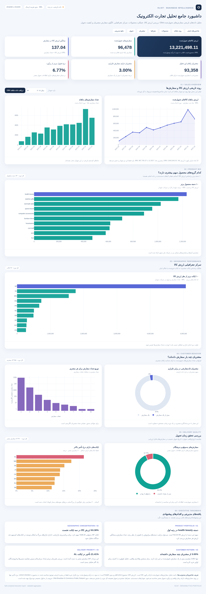

# تحلیل داده‌های تجارت الکترونیک Olist

یک پروژه نمونه‌کار تحلیل داده با Python و Pandas که داده‌های تاریخی Olist برزیل را بررسی می‌کند و داشبورد تعاملی فارسی ارائه می‌دهد.



## خروجی‌های واقعی

- ۹۹٬۴۴۱ سفارش ثبت‌شده در دیتاست (همه وضعیت‌ها)
- ۹۶٬۴۷۸ سفارش تحویل‌شده با اقلام ثبت‌شده
- ارزش کالاهای تحویل‌شده: **۱۳٬۲۲۱٬۴۹۸٫۱۱ رئال برزیل**، بدون هزینه ارسال
- میانگین ارزش کالا در هر سفارش تحویل‌شده: **۱۳۷٫۰۴ رئال**
- ۹۳٬۳۵۸ مشتری یکتا؛ از این تعداد ۲٬۸۰۱ مشتری (۳٪) بیش از یک سفارش تحویل‌شده داشته‌اند
- نرخ رسیدن دیرتر از تاریخ تخمینی: **۶٫۷۷٪** (۶٬۵۳۴ سفارش از ۹۶٬۴۷۰ سفارش قابل سنجش)

ارزش کالا **سود یا درآمد وصول‌شده نیست**. نرخ تکرار سفارش نیز به‌معنای نرخ نگهداشت یا وفاداری بلندمدت نیست.

## چه کاری انجام شده؟

بارگذاری داده، کنترل کلیدها و روابط، جلوگیری از چندباره‌شماری سفارش هنگام ادغام جدول‌ها، تحلیل محصول، جغرافیا، رفتار مشتری و زمان تحویل، ساخت نمودارهای تعاملی و گزارش‌های قابل ذخیره.

## نحوه اجرا

```bash
pip install -r requirements.txt
python src/olist_analysis.py --reports-dir reports --output-dir olist_output
```

فرمان بالا **بدون دانلود دیتاست خام** داشبورد را از خروجی‌های تأییدشده موجود می‌سازد. برای اجرای تمام مراحل از دیتاست خام به اتصال اینترنت نیاز دارید:

```bash
python src/olist_analysis.py --output-dir olist_output
```

نسخه مناسب Colab در پوشه `notebooks/` قرار دارد. فایل داشبورد قابل بازکردن در مرورگر: `docs/index.html`.

برای بررسی صحت محاسبات:

```bash
python -m unittest discover -s tests -v
```

## منبع و شرایط استفاده

دیتاست اصلی از [Kaggle / Olist](https://www.kaggle.com/datasets/olistbr/brazilian-ecommerce) با مجوز **CC BY-NC-SA 4.0** است؛ فایل‌های خام آن در مخزن کپی نشده‌اند. گزارش‌های تجمیعی نیز باید با رعایت شرایط مجوز منبع استفاده شوند. برای جزئیات به `DATA_SOURCE_AND_LICENSE.md` مراجعه کنید.

**نسخه انگلیسی و توضیحات کامل‌تر:** [README.md](README.md)
